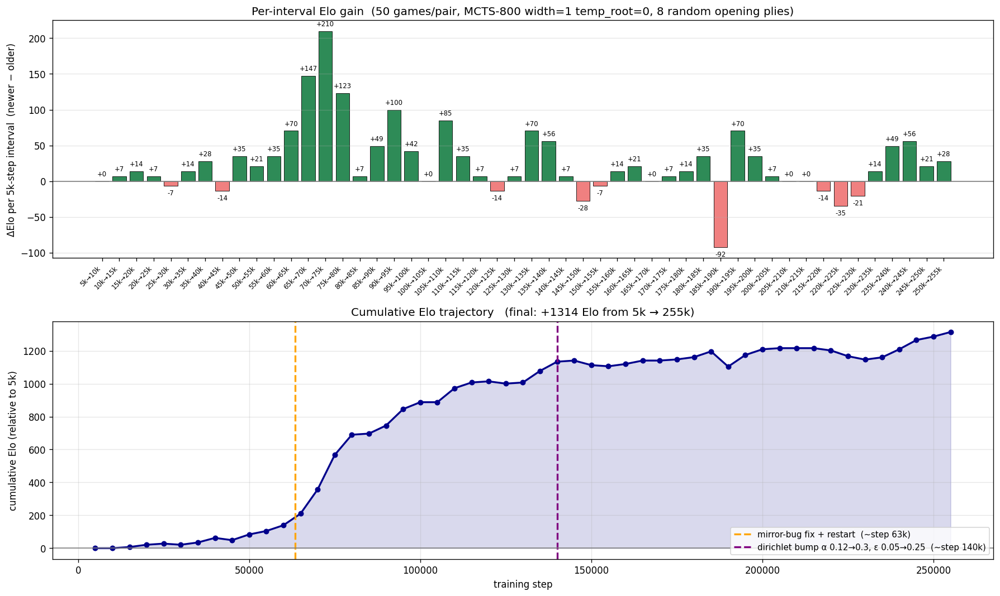
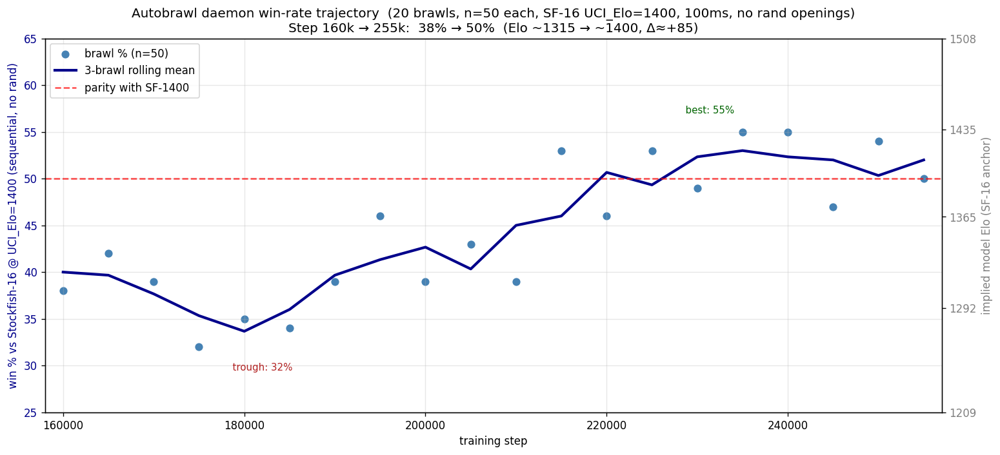

# ChessRL

A small AlphaZero from scratch.

ChessRL is a 1.29M-parameter chess agent that learns the game purely from
self-play, no human games, no opening book. C++ MCTS workers generate
self-play positions; a PyTorch trainer consumes them and publishes new
TensorRT engines back into the self-play loop. Everything runs on a single
GPU.

The trainer has been running continuously since 2026-05-15; the current
build plays at ~Stockfish 1400 on a 100ms-per-move budget.

## Write-ups

- [ChessRL: training an AlphaZero from scratch on a single consumer GPU](https://mvdbk.fr/blog/chessrl-alphazero-single-gpu):
  the architecture, the self-play loop, the performance work, and the bugs
  that taught the most.
- [ChessRL, continued: 9× faster self-play learning on a single RTX 4090](https://mvdbk.fr/blog/chessrl-next-round):
  better training targets, a small transformer and a cheaper search, an FP16
  bug that looked like a collapse, and a network that beats Stockfish limited
  to 2000 Elo.

## Live progress

The two graphs below regenerate from disk every time the training run
crosses a 5k-step boundary — they're the source of truth, not a snapshot.

**Elo chain** — head-to-head against the model's own past checkpoints (50
games per pair, MCTS-800, width=1, 8 random opening plies):



**Win rate vs Stockfish-1400** — sequential 100 ms/move matches (autobrawl
daemon, n=50 per checkpoint):



Plus the interactive [dashboard](#dashboard) for a live view.

## Prerequisites

- **GPU**: any NVIDIA card with compute capability ≥ 8.0 (Ampere/Ada/Hopper).
  Tested on H200; 4090 / A100 / 3090 work with the `CHESSRL_CUDA_ARCH`
  override below.
- **CUDA Toolkit** 12.x with `nvcc` available. Install from
  https://developer.nvidia.com/cuda-downloads.
- **TensorRT** ≥ 10.14. Get the tarball from
  https://developer.nvidia.com/tensorrt and extract it to a stable path
  (the default below works); apt installs also work.
- **uv** (Python package manager) — `curl -LsSf https://astral.sh/uv/install.sh | sh`.
  uv handles the Python 3.13 install itself.
- A C++17 compiler (system `g++` is fine).

## Install

```bash
git clone <repo> && cd ChessRL

# 1) Verify your host has everything we need (fails loud with hints if not).
bash scripts/check_install.sh

# 2) Tell the build where TensorRT lives and which GPU arch to compile for.
export TENSORRT_ROOT=/usr/local/TensorRT-10.14.1.48
export CHESSRL_CUDA_ARCH=sm_90        # sm_89 for 4090, sm_86 for 3090, sm_80 for A100

# 3) Build the C++ extension + install Python deps.
uv sync

# 4) Smoke-test the suite.
uv run pytest -m "not gpu and not trt"
```

## Run

All commands assume the repo root as the working directory.

```bash
# Start a fresh run. Creates artifacts/runs/<id>/ with isolated subdirs for
# buffer/, engines/, checkpoints/, pgns/, wandb/, plus a snapshot of the
# resolved config. Builds an initial random-init TRT engine so self-play
# has something to play with from the first second.
uv run python -m src.run --name my-first-run

# Resume an existing run (continues from the latest checkpoint).
uv run python -m src.run --resume artifacts/runs/<id>

# Watch the per-process logs.
tail -f artifacts/runs/<id>/selfplay.log
tail -f artifacts/runs/<id>/training.log
```

Other useful invocations:

```bash
# Only one side (debugging).
uv run python -m src.run --no-train      # self-play only
uv run python -m src.run --no-selfplay   # trainer only

# Manually convert a checkpoint to a TensorRT engine.
scripts/build_trt.sh artifacts/runs/<id>/checkpoints/step_00043900.pt 43900 \
    artifacts/runs/<id>/engines artifacts/runs/<id>/engines/.iteration

# Head-to-head between two checkpoints.
uv run python -m src.eval.brawls \
    --num_games 100 --model1 small --model2 small \
    --ckpt1 artifacts/runs/<id_a>/checkpoints/step_*.pt \
    --ckpt2 artifacts/runs/<id_b>/checkpoints/step_*.pt

# Prune artifacts (keep only the last N step checkpoints + matching engines).
uv run python scripts/prune_artifacts.py            # dry-run
uv run python scripts/prune_artifacts.py --apply
```

## Dashboard

A Streamlit dashboard summarises a live training run on one page (win-rate
vs Stockfish, castle rate, Elo chain).

```bash
uv run streamlit run scripts/dashboard.py
# then open http://localhost:8501
```

The dashboard is read-only — never modifies the training run, the buffer,
or any artifact. Castle rate is fetched from W&B (see
[Logging to W&B](#logging-to-wb)); the other two sources are read straight
from `artifacts/exp/`.

## How it works (5 bullets)

1. `src.self_play` runs a C++ MCTS loop, batching ~128 boards/sim and
   writing 832-byte records to `artifacts/runs/<id>/buffer/buffer.bin`.
2. `src.train` consumes the buffer, computes policy + value + MLH losses,
   and saves PyTorch checkpoints every `every_steps` steps.
3. Each new checkpoint is converted to a TensorRT engine
   (`scripts/build_trt.sh`) and written to
   `artifacts/runs/<id>/engines/step_*.trt`.
4. `engines/.iteration` is updated with the path to the latest engine;
   self-play reloads on the next sim boundary, no restart needed.
5. The two `src.run` subprocesses share the same config snapshot and
   communicate only through the buffer file + iteration pointer — no IPC,
   no shared memory.

## Configuration

The full schema lives in `src/train/config.yaml` (with field-level
docstrings in `src/train/config.py`). The five knobs you'll touch most:

| Knob | What it does |
|------|--------------|
| `selfplay.simulations` | MCTS sims per move. Higher = stronger play data, slower throughput. Currently 800. |
| `mcts.dirichlet_alpha` / `mcts.dirichlet_epsilon` | Root exploration noise. Canonical AZ values: α=0.3, ε=0.25. |
| `mcts.cpuct` | PUCT exploration constant. Lower = more exploitation. |
| `data.target_k` | Each self-play record is re-sampled this many times before churning out. Trainer paces itself to hit this target. AZ ≈ 3, LC0 ≈ 5, aggressive 10+. |
| `train.loss_weights.{policy,value,value_q,mlh}` | Loss head weights. Imbalance = head-mode collapse. |

See [`docs/CONFIG.md`](docs/CONFIG.md) for the full walkthrough.

## Logging to W&B

Set `wandb.entity` in `src/train/config.yaml` (or pass `--wandb-entity` if
you don't want to edit the file). The trainer logs the usual training
curves plus:

- `buffer/castle_rate` — fraction of buffer rows that are castle UCIs
  (rare-action learning signal; canonical chess is 0.8–1.2%).
- `eval/sf1400_win_pct` + `eval/sf1400_implied_elo` — pushed by the
  autobrawl daemon at each 5k checkpoint (see below).
- `eval/elo_delta_per_5k` + `eval/elo_cumulative` — pushed by
  `model_chain_brawl.py` after each chain evaluation.

External producers attach to the trainer's W&B run via
`<run_dir>/wandb_run_id.txt`, which the trainer writes at startup.
Producers fail-soft if the file is missing or W&B is unreachable.

## Evaluation

Three ways to measure progress, in increasing cost:

1. **Autobrawl daemon** (`scripts/sf1400_autobrawl.py`) — runs continuously,
   brawls every new 5k checkpoint vs Stockfish 1400 for 50 games. Results
   land in `artifacts/exp/sf1400_autobrawl/state.json`; PGNs in
   `artifacts/pgns/`.
2. **Chain Elo** (`scripts/model_chain_brawl.py`) — one-shot pairwise
   matches of consecutive 5k-step checkpoints. Writes
   `artifacts/exp/elo_chain*/results.csv`. Use `replot_elo_chain.py` to
   merge and render.
3. **Manual SF match** (`scripts/stockfish_match.py`) — full control over
   opponent strength, time per move, number of games.

## Troubleshooting

| Symptom | Cause / fix |
|---|---|
| `nvcc not at /usr/local/cuda/bin/nvcc` | `/usr/local/cuda` symlink missing or pointing at a versioned CUDA that lacks `nvcc`. `export CUDA_ROOT=/usr/local/cuda-12.8` (or wherever your `nvcc` lives). |
| `error: [Errno 2] No such file ... nvcc` during `uv sync` | same as above; `scripts/check_install.sh` would have caught this. |
| `TENSORRT_ROOT=... but ...NvInfer.h does not exist` | TensorRT tarball wasn't extracted at that path, or `TENSORRT_ROOT` is stale. Unset it to fall back to apt TRT, or fix the path. |
| `libcudart.so.12: cannot open shared object file` at runtime | `LD_LIBRARY_PATH` doesn't include the CUDA 12.x lib dir. `export LD_LIBRARY_PATH=/usr/local/cuda-12.8/targets/x86_64-linux/lib`. |
| `CHESSRL_CUDA_ARCH=... is malformed` | use one of `sm_90` (H200/Hopper), `sm_89` (4090/Ada), `sm_86` (3090/Ampere), `sm_80` (A100). |
| `_inference_cpp` import works but inference is slow | wrong arch compiled in. Set `CHESSRL_CUDA_ARCH` to match your GPU and rerun `uv sync` to force a rebuild. |

## Scripts overview

| Script | What it does |
|---|---|
| `check_install.sh` | Preflight: validates uv, nvcc, TensorRT, GPU arch. **Run first on a fresh box.** |
| `build_trt.sh` | Convert a `.pt` checkpoint to a `.trt` engine via `trtexec`. |
| `build_cpp_tests.sh` | Build the C++ doctest binary at `cpp/build/tests/cpp_tests`. |
| `prune_artifacts.py` | Keep only the most recent N checkpoints + matching engines. |
| `audit_buffer.py` | Buffer diagnostics: WDL decisiveness, policy entropy, MLH coverage. |
| `stockfish_match.py` | Brawl one model vs Stockfish at a chosen UCI_Elo. |
| `bench_selfplay.py` + `perfreport.py` | Self-play throughput benchmark + A/B reporter. |
| `mcts_worker.py` | Persistent MCTS worker w/ JSON stdin protocol (used by cross-arch brawls). |
| `generate_selfplay_pgns.py` | Dump full PGNs from the current model for offline analysis. |
| `sf1400_autobrawl.py` | Daemon: brawls every new 5k checkpoint vs SF-1400. |
| `model_chain_brawl.py` | One-shot chain Elo evaluation across 5k-step intervals. |
| `replot_elo_chain.py` / `plot_autobrawl_trend.py` | Re-render the README graphs from CSV/JSON. |
| `dashboard.py` | The Streamlit dashboard (see above). |

## Tests

```bash
uv run pytest                            # full suite (skips gpu/trt if unavailable)
uv run pytest -m "not gpu and not trt"   # CPU-only

bash scripts/build_cpp_tests.sh && cpp/build/tests/cpp_tests   # C++ doctest
```

## Layout

- `src/` — Python source (training, self-play orchestrator, MCTS bindings,
  models, eval, export, opening generators).
- `cpp/` — pybind11 C++ inference extension + chess library + MCTS kernels.
- `scripts/` — production tooling (see table above).
- `tests/` — pytest suite (encoder parity, packed-kernel parity, etc.).
- `docs/` — extended docs (`ARCHITECTURE.md`, `CONFIG.md`).
- `archive/legacy_scripts/` — frozen one-time migrations and investigation
  scripts. Reference only; nothing in `src/` should import from here.
- `artifacts/runs/<id>/` — per-run state. Gitignored.
- `artifacts/exp/` — long-running experiment outputs (autobrawl state,
  elo chain CSVs, the two README graphs).
