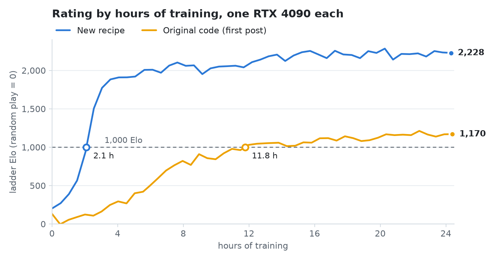
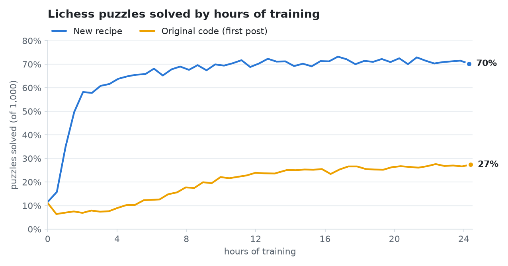

# ChessRL

A small AlphaZero, trained from scratch on one GPU.

ChessRL learns chess only by playing against itself: no human games, no opening book. C++ workers
play thousands of games at once with Monte Carlo tree search (MCTS), running the network through
TensorRT in 16-bit floating point; a PyTorch trainer learns from the positions they save and
publishes new engines back into the running games.

With the default recipe, on one RTX 4090, the network passes 1,000 Elo after about 2 hours and
reaches about 2,230 after 24 hours on our rating ladder. Searching 800 simulations per move, it
then scores 79% against Stockfish 16 limited to 2000 Elo (31 wins, 1 draw, 8 losses).

## Results

The default recipe against the code of the [first post](#write-ups) (commit
[`128893c`](https://github.com/maxlegrec1/ChessRL/tree/128893c96f2921fda19d1d940617b198754aff75)),
24 hours each on one RTX 4090. Ratings are on the ladder described under
[Measuring strength](#measuring-strength), where random play is 0.

<picture>
  <source media="(prefers-color-scheme: dark)" srcset="docs/img/elo_dark.png">
  
</picture>

<picture>
  <source media="(prefers-color-scheme: dark)" srcset="docs/img/puzzles_dark.png">
  
</picture>

| | 1,000 Elo after | after 24 h | puzzles solved after 24 h |
|---|---|---|---|
| Original code (first post) | 11.8 h | 1,170 | 27% |
| Default recipe | **2.1 h** | **2,230** | **70%** |

The charts are drawn by `docs/blog/make_charts.py --readme` from the data of the second post.

## Write-ups

- [AlphaZero from scratch: training a chess AI on a single consumer GPU](https://mvdbk.fr/blog/chessrl-alphazero-single-gpu):
  the architecture, the self-play loop, the performance work, and the bugs that taught the most.
  It describes commit `128893c`.
- [AlphaZero from scratch, continued: 6× faster on a single RTX 4090](https://mvdbk.fr/blog/alphazero-from-scratch-rtx-4090):
  better training targets, a small transformer and a cheaper search, an FP16 bug that looked like a
  collapse, and a network that beats Stockfish limited to 2000 Elo. The lab log behind it is
  [`docs/NEXT_ROUND.md`](docs/NEXT_ROUND.md).

## How it works

1. `python -m src.run` creates `artifacts/runs/<id>/`, copies the config there, builds an engine
   from a randomly initialised network, and starts two processes: self-play and the trainer.
2. **Self-play** (`src/self_play`, C++ in `cpp/`) plays 1,024 games at once. A quarter of the moves
   get a full 400-simulation search and are saved to the buffer file with the search's visit
   counts; the others get a 50-simulation search that only moves the game forward.
3. **The trainer** (`src/train`) samples batches of 2,048 positions from the newest part of the
   buffer and trains the network's outputs: the move probabilities (towards the visit counts), the
   expected result (towards the game's result) and the number of moves left.
4. Every 500 steps it saves a checkpoint and builds a TensorRT engine in the background
   (`scripts/build_trt.sh`). Self-play loads each new engine between moves, without restarting.
5. The two processes share nothing but files: the buffer and `engines/.iteration`, which points at
   the newest engine. Either can be stopped and resumed on its own.

[`docs/ARCHITECTURE.md`](docs/ARCHITECTURE.md) has the details.

## The recipe

[`src/train/config.yaml`](src/train/config.yaml) is the default config. Its main settings:

- **Network**: a transformer with one token per square (0.81M parameters, `model.arch: encoder`).
  A ResNet is also available (`model.arch: resnet`).
- **Training targets**: the policy learns the search's visit counts (`policy_target: visits`); the
  search reads the value output trained on game results (`search_heads: outcome`).
- **Search**: playout-cap randomisation, 25% of moves at 400 simulations (saved) and 75% at 50.
  Moves are sampled from the visit counts for the first 30 plies, then the most visited move is
  played. Dirichlet noise (α 0.3, ε 0.25) on full searches. Every game starts with 8 random plies.
- **Resignation** below 5% expected score for 3 moves in a row; 10% of games are played to the end
  to check that resigning was right.
- **Optimiser**: AdamW, learning rate 1e-3 with a 1,000-step warmup, weight decay 0.05 on weight
  matrices (it keeps activations inside FP16 range).
- **Buffer**: a 2M-record ring, sampled through a window that grows with the data.

Every field is described in [`docs/CONFIG.md`](docs/CONFIG.md).

## Prerequisites

- **GPU**: an NVIDIA card with compute capability 8.0 or higher (Ampere, Ada, Hopper). Used on an
  RTX 4090 and an H200.
- **CUDA Toolkit** 12.x with `nvcc`: https://developer.nvidia.com/cuda-downloads.
- **TensorRT** 10.14 or later: the tarball from https://developer.nvidia.com/tensorrt (extract it to
  a stable path), or NVIDIA's apt packages.
- **uv**: `curl -LsSf https://astral.sh/uv/install.sh | sh`. It installs Python 3.13 itself.
- A C++17 compiler (the system `g++` is fine).
- **Stockfish 16** for the rating ladder (`apt install stockfish`). Training runs without it.

## Install

```bash
git clone --recurse-submodules https://github.com/maxlegrec1/ChessRL.git && cd ChessRL

# 1) Check the host (fails with a hint for anything missing).
bash scripts/check_install.sh

# 2) Where TensorRT lives, and which GPU architecture to compile for.
export TENSORRT_ROOT=/usr/local/TensorRT-10.14.1.48
export CHESSRL_CUDA_ARCH=sm_89        # sm_89 RTX 4090, sm_90 H100/H200, sm_86 RTX 3090, sm_80 A100

# 3) Build the C++ extension and install the Python dependencies.
uv sync

# 4) Run the tests that need no GPU.
uv run pytest -m "not gpu and not trt"
```

## Run

All commands run from the repository root.

```bash
# Start a run with the default recipe. Creates artifacts/runs/<id>/ (buffer, engines,
# checkpoints, metrics, logs and a copy of the config).
uv run python -m src.run --name my-run

# Start a run with another config (for example an edited copy of src/train/config.yaml).
uv run python -m src.run --config my_config.yaml --name my-variant

# Resume a run from its latest checkpoint, with its own config.
uv run python -m src.run --resume artifacts/runs/<id>

# Follow the logs.
tail -f artifacts/runs/<id>/selfplay.log artifacts/runs/<id>/training.log

# Only one side, for debugging.
uv run python -m src.run --no-train      # self-play only
uv run python -m src.run --no-selfplay   # trainer only

# Build an engine from a checkpoint by hand.
scripts/build_trt.sh artifacts/runs/<id>/checkpoints/step_00010000.pt 10000 /tmp/engines /tmp/engines/.iteration
```

The trainer writes `metrics/train.jsonl` and self-play `metrics/selfplay.jsonl` in the run
directory. Weights & Biases logging is off by default (`wandb.enabled` in the config).

## Measuring strength

**The rating ladder** (`scripts/ladder_daemon.py`) rates the newest engine of a run every 30 minutes:

```bash
uv run python scripts/ladder_daemon.py --run-dir artifacts/runs/<id>
```

Each rating is 96 games at 100 simulations per move against the two reference opponents nearest the
network's level (a random player, a player that always captures, and Stockfish 16 at several reduced
strengths, rated once among themselves with random play at 0), plus 48 more against the next one up
(or down) each time the network scores 85% or more (or 15% or less), up to three times. Every game starts from one of 24
openings that Stockfish judges balanced. Each rating also solves 1,000 Lichess puzzles. Results go to
`<run>/ladder/ladder.jsonl`; a rating is about ±45 Elo.

**The first post's test**, Stockfish 16 limited to a given Elo at 100 ms per move, with the network
searching 800 simulations per move:

```bash
uv run python scripts/sf_benchmark.py --engines a.trt b.trt --elo 1400 2000 --games 40 --out bench.jsonl
```

**Engine check**: `scripts/trt_parity.py ckpt.pt` compares a checkpoint's TensorRT FP16 engine with
PyTorch on the same positions (top-move agreement, policy KL divergence, value error).

## Dashboard and analysis board

```bash
uv run streamlit run scripts/dashboard.py          # http://localhost:8501
uv run python scripts/analysis_server.py --port 8510
```

The dashboard is read-only. It shows every run under `artifacts/runs/` (or the directories in
`$CHESSRL_RUNS_ROOT`, separated by colons): ladder Elo and puzzles by hours of training, losses,
self-play speed and game statistics. Its "Analysis" page embeds the analysis board, which runs a
checkpoint's search on the CPU for any position.

## Scripts

| Script | What it does |
|---|---|
| `check_install.sh` | Checks uv, the GPU, `nvcc`, TensorRT, Stockfish and the target architecture. Run it first. |
| `build_trt.sh` | Converts a checkpoint to a TensorRT engine (PyTorch → ONNX → TensorRT FP16). |
| `build_cpp_tests.sh` | Builds the C++ tests (`cpp/build/tests/cpp_tests`). Needs only g++. |
| `bench_cpu_search.sh` | CPU benchmark of the self-play search with a fake network, no GPU: CPU time per evaluation and a digest of the search results (built by `build_cpu_bench.sh`; positions from `make_bench_positions.py`). |
| `ladder_daemon.py` | Rates a run's newest engine on the ladder, every 30 minutes. |
| `rerate.py` | Re-rates saved checkpoints on a chosen opening set. |
| `calibrate_finish.py` | Finishes an interrupted calibration of the ladder's reference opponents. |
| `make_sf_openings.py`, `make_puzzle_set.py` | Build the ladder's balanced openings and its 1,000-puzzle set (both are in `data/`). |
| `sf_benchmark.py` | The first post's Stockfish test, for several engines and Stockfish levels in parallel. |
| `stockfish_match.py` | One match of an engine against Stockfish at a fixed Elo. |
| `cpu_stockfish_match.py` | The same test with the network searching on the CPU (no TensorRT needed). |
| `puzzle_scan.py`, `showcase_games.py` | Hard puzzles solved by a checkpoint, and games against one ladder opponent (PGN). |
| `trt_parity.py` | TensorRT engine against PyTorch, per checkpoint. |
| `check_buffer.py` | Checks buffer records against python-chess. |
| `bench_selfplay.py`, `perfreport.py` | Self-play speed benchmark with the training config, and a side-by-side report of two benchmarks. |
| `dashboard.py`, `pages/1_Analysis.py`, `analysis_server.py` | The dashboard and the analysis board. |
| `vast/` | Running on rented Vast.ai GPUs: launch with a budget guard, box setup, metric sync. |

## Tests

```bash
uv run pytest                            # everything (GPU and TensorRT tests skip if unavailable)
uv run pytest -m "not gpu and not trt"   # CPU only

bash scripts/build_cpp_tests.sh && cpp/build/tests/cpp_tests   # C++ tests
```

## Troubleshooting

| Symptom | Cause / fix |
|---|---|
| `nvcc not at /usr/local/cuda/bin/nvcc` | The `/usr/local/cuda` link is missing or points at a CUDA without `nvcc`. `export CUDA_ROOT=/usr/local/cuda-12.8` (wherever your `nvcc` is). |
| `error: [Errno 2] No such file ... nvcc` during `uv sync` | Same as above; `scripts/check_install.sh` catches it. |
| `TENSORRT_ROOT=... but ...NvInfer.h does not exist` | TensorRT is not extracted at that path. Fix the path, or unset it to use the apt packages. |
| `libcudart.so.12: cannot open shared object file` | Add the CUDA 12 library directory to `LD_LIBRARY_PATH`, e.g. `/usr/local/cuda-12.8/targets/x86_64-linux/lib`. |
| `CHESSRL_CUDA_ARCH=... is malformed` | Use `sm_` followed by the compute capability: `sm_89` (RTX 4090), `sm_90` (H100/H200), `sm_86` (RTX 3090), `sm_80` (A100). |
| The extension imports but self-play is slow | It was compiled for another architecture. Set `CHESSRL_CUDA_ARCH` and run `uv sync` again. |

## Layout

- `src/run.py`: the launcher. `src/self_play/`: the self-play process. `src/train/`: the trainer, the
  buffer reader and the config (`config.yaml` is the recipe).
- `src/models/`: the transformer (`encoder.py`), the ResNet (`small/`), growth and model loading.
- `src/export/`: checkpoint to ONNX. `src/rating/`: the ladder. `src/analysis/`: the CPU search
  behind the analysis board.
- `cpp/`: the C++ extension (MCTS, self-play, TensorRT inference, position encoding) and the chess
  library (a git submodule).
- `scripts/`: the tools above. `tests/`: the Python tests.
- `data/`: the ladder's balanced openings and the 1,000 puzzles.
- `docs/`: `ARCHITECTURE.md`, `CONFIG.md`, the lab log `NEXT_ROUND.md`, the README charts, and the
  blog posts with their charts (`docs/blog/`).
- `artifacts/`: runs and other generated files (not tracked).

## License

MIT.
